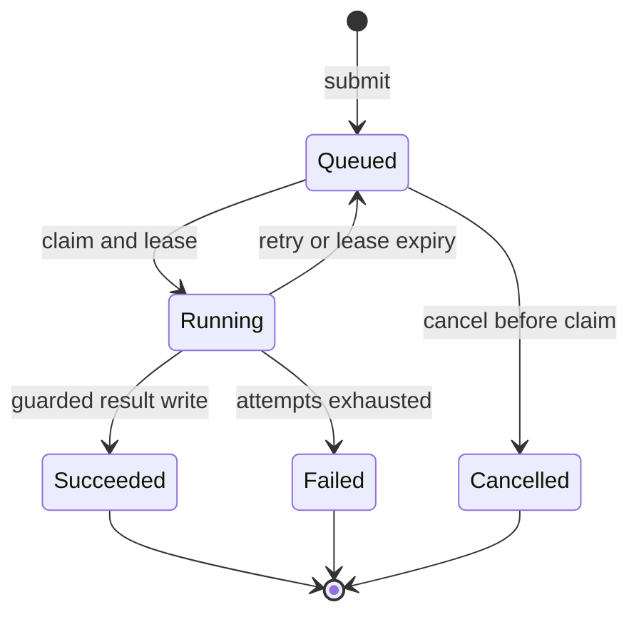

# Distributed Job Scheduler

A backend engineering portfolio project for Yashwanth Pulimi. Submit work through a FastAPI API, persist it in PostgreSQL, and process it with independently scalable worker processes.

The implementation includes priority scheduling, age-based promotion, concurrent claims, retries, worker leases, heartbeat renewal, stale-result rejection, request idempotency, attempt history, and tests. It is a learning/portfolio implementation, not a production-hardened hosted service.

**Start with [the step-by-step guide](docs/STEP_BY_STEP.md).** You do not need to write all the code from scratch: run it, study one component at a time, make changes, and verify them.

## What this demonstrates for SDE roles

| Skill | Concrete implementation |
|---|---|
| Backend APIs | Validated job submission, status, attempt history, cancellation, and statistics |
| Data modeling | Job and attempt tables, constraints, indexes, and transactions |
| Concurrency | Multiple workers claim rows with `FOR UPDATE SKIP LOCKED` |
| Reliability | Expiring leases, heartbeats, capped retries, and terminal failed state |
| Duplicate handling | Submission idempotency keys and guarded result writes |
| Algorithms | Priority selection, FIFO tie-breaking, age-based promotion, exponential backoff |
| Software design | Separate API, repository (`Store`), worker, and handler modules |
| Testing | Unit/API-validation tests plus real-PostgreSQL integration tests |
| Delivery | Docker Compose setup and a GitHub Actions test workflow |

## Quick start

Install Docker Desktop with Compose v2, or Docker Engine with the Compose plugin. Start Docker, extract this project, and open a terminal inside the folder containing `compose.yaml`.

```bash
docker compose up --build -d
docker compose ps
docker compose exec api python scripts/demo.py
docker compose --profile test run --build --rm test
```

Wait until the API is healthy before running the demo. `migrate` exiting with code 0 is expected. Open <http://localhost:8000/docs> to inspect the API. Protected routes require the `X-API-Key` header; the development default is `local-development-only`. No host Python install is needed for these Docker commands.

To submit a job with curl:

```bash
curl -X POST http://localhost:8000/jobs \
  -H 'Content-Type: application/json' \
  -H 'X-API-Key: local-development-only' \
  -H 'Idempotency-Key: first-sum-job' \
  -d '{"kind":"sum","payload":{"numbers":[10,20,30]},"priority":8,"max_attempts":3}'
```

Use `curl.exe` in Windows PowerShell, or run the cross-platform `scripts/demo.py` command through Compose instead. The returned `id` identifies the job. Repeat the same POST and key to get the same job; change the body with the same key to receive HTTP 409.

## Job lifecycle



The API writes jobs. Workers poll PostgreSQL and claim eligible rows in a short transaction. The row lock ends before the handler starts. During execution, a separate heartbeat thread renews the lease. If a worker disappears, a polling worker detects the expired lease and either requeues the job after a delay or marks it failed when the attempt budget is exhausted.

Each claim gets a new random token. Heartbeats and completion updates must match that token and an unexpired lease. This prevents an old attempt from writing a result over a newer attempt.

## API

All routes except `/health` and documentation require `X-API-Key`.

| Method | Path | Behavior |
|---|---|---|
| POST | `/jobs` | Create a job; optional `Idempotency-Key`; 201 new / 200 replay / 409 conflict |
| GET | `/jobs/{id}` | State, payload, result, timing, attempt count |
| GET | `/jobs/{id}/attempts` | Recorded attempts and their outcomes |
| GET | `/jobs?state=failed&limit=50` | Up to 100 recent jobs, optionally filtered |
| POST | `/jobs/{id}/cancel` | Cancel only queued jobs; 409 if already running/terminal |
| GET | `/stats` | Counts and p50/p95 completion latency across successful jobs |
| GET | `/health` | Database-backed readiness check |

Job kinds are allowlisted: `sum`, `word_count`, and `demo`. They do not execute arbitrary user code. The `demo` handler accepts `duration_seconds` (0..30) and `fail_first_attempts` (0..5) for reproducible retry experiments. `scheduled_at`, if supplied, must be a timezone-aware timestamp; past timestamps are treated as immediately eligible. Priority is 0..10, with larger values preferred. `max_attempts` includes the initial attempt.

## Code map

| File | Responsibility |
|---|---|
| `scheduler/models.py` | Request and payload validation |
| `scheduler/schema.sql` | Job/attempt data model and indexes |
| `scheduler/store.py` | Atomic state transitions, scheduling queries, idempotency |
| `scheduler/api.py` | HTTP contract and API-key checks |
| `scheduler/handlers.py` | Small, bounded example workloads |
| `scheduler/worker.py` | Worker concurrency, heartbeats, shutdown, structured logs |
| `scheduler/config.py` | Validated environment settings |
| `tests/test_unit.py` | Tests that do not require PostgreSQL |
| `tests/test_postgres.py` | Actual database and multi-connection tests |
| `scripts/demo.py` | End-to-end submission/idempotency/retry demo |
| `scripts/benchmark.py` | Measurements scoped to one run |

## Guarantees and limits

- **Execution is at least once**, not exactly once. A crash after an external side effect but before a result commit can cause the handler to run again. The submission key prevents duplicate job creation; it does not make external actions duplicate-safe. Use the job ID as an idempotency key at downstream services or add a transactional outbox before adding emails/payments.
- Tokens fence writes to this database. They cannot interrupt a paused worker or fence an external system. Sample handlers support cooperative lease-loss cancellation; arbitrary blocking handlers would need deadlines and stronger process isolation.
- The queue is a PostgreSQL table, not an in-memory heap. Selection uses `priority + floor(wait_seconds / AGING_SECONDS)` with submission sequence as a tie-breaker. Retries restart aging. Claim order under contention is approximate because locked rows are skipped; completion order is not guaranteed. Finite capacity still limits service under overload.
- A fixed lease plus heartbeats recovers crashed workers. Crash attempts count toward `max_attempts`. A failed job is retained for inspection; there is no automatic infinite replay.
- Workers use threads for concurrency. The sample sleep workload is I/O-like; CPU-heavy Python jobs require process workers or another execution runtime to scale across cores.
- Connections are short-lived and opened per operation. This is easy to inspect but adds overhead. A bounded connection pool, query tuning, admission control, retention cleanup, and pagination are next steps for larger workloads.
- `/stats` computes aggregates over retained rows. It is not a Prometheus monitoring system. No throughput or availability SLO is claimed.
- This is a single-tenant, locally bound demo. The default key/password are development settings. A public deployment needs TLS, real authentication/authorization, secret management, payload/rate limits, network controls, and operational monitoring.
- The schema initializer is idempotent for initial setup, not a versioned migration system. Introduce migrations before changing a deployed schema.

## Testing status

See [VALIDATION.md](docs/VALIDATION.md) for the exact checks executed while preparing this package. A test that says `SKIPPED` is not a passing integration test. Run the Compose test command and require **zero skips** before treating database behavior as verified on your machine.

## References

The implementation is original code. These primary sources explain the underlying primitives:

- PostgreSQL SELECT and queue-oriented `SKIP LOCKED`: <https://www.postgresql.org/docs/current/sql-select.html>
- Psycopg transaction context managers: <https://www.psycopg.org/psycopg3/docs/basic/transactions.html>
- FastAPI testing: <https://fastapi.tiangolo.com/tutorial/testing/>
- FastAPI lifespan testing: <https://fastapi.tiangolo.com/advanced/testing-events/>

